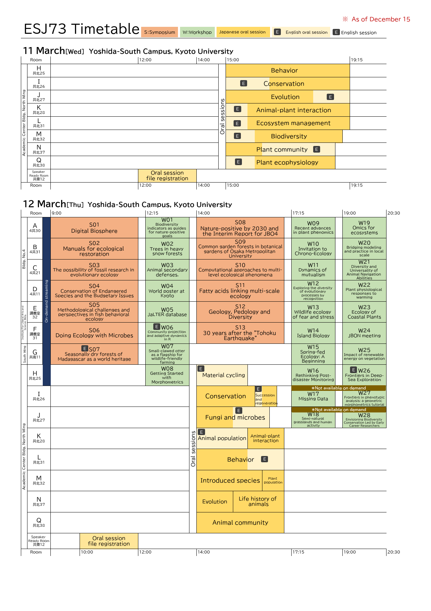
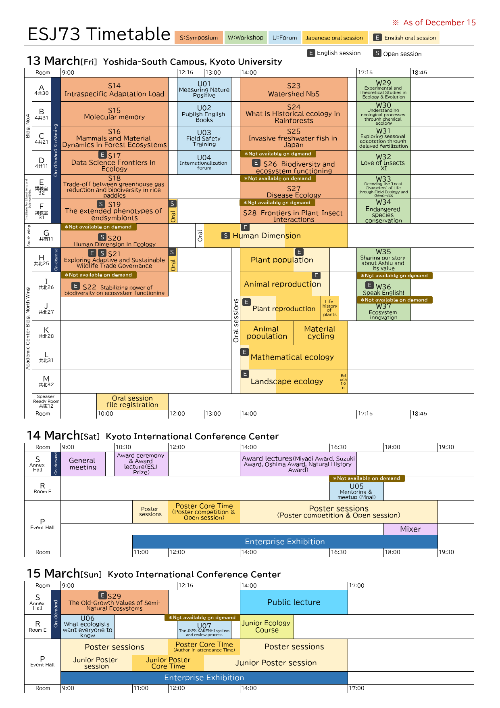
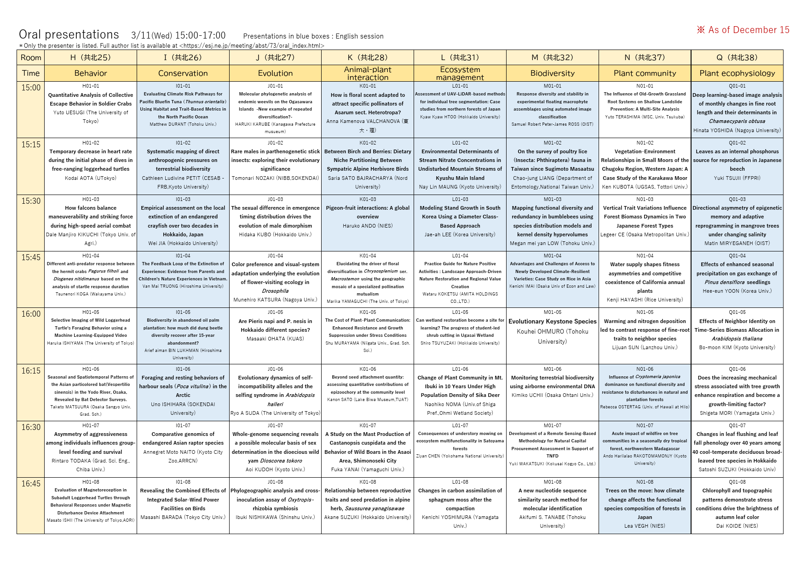
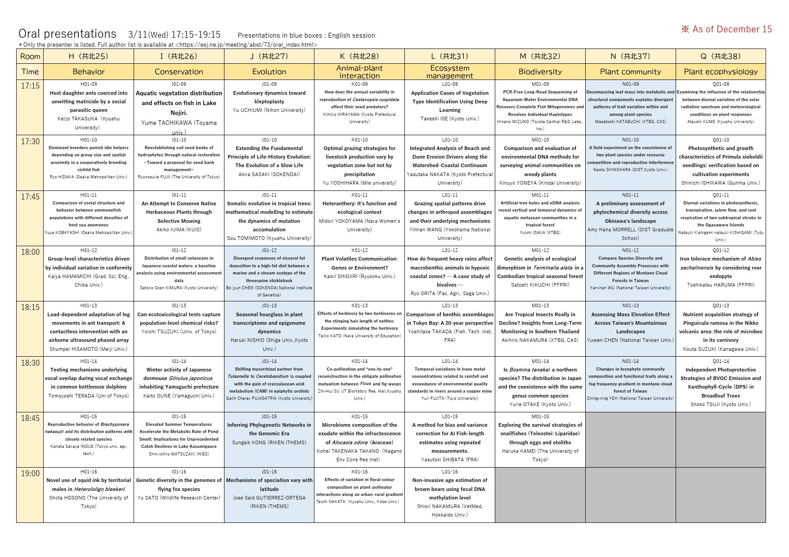
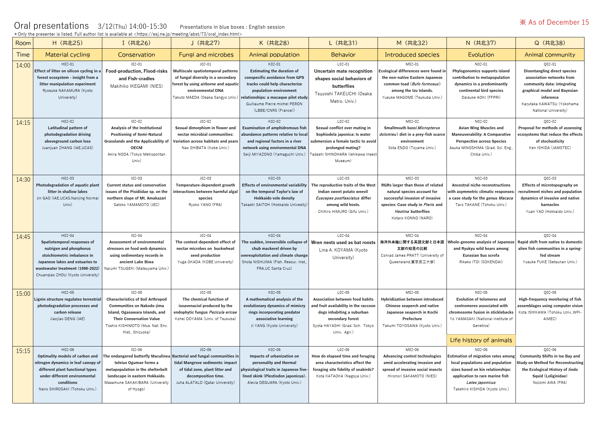
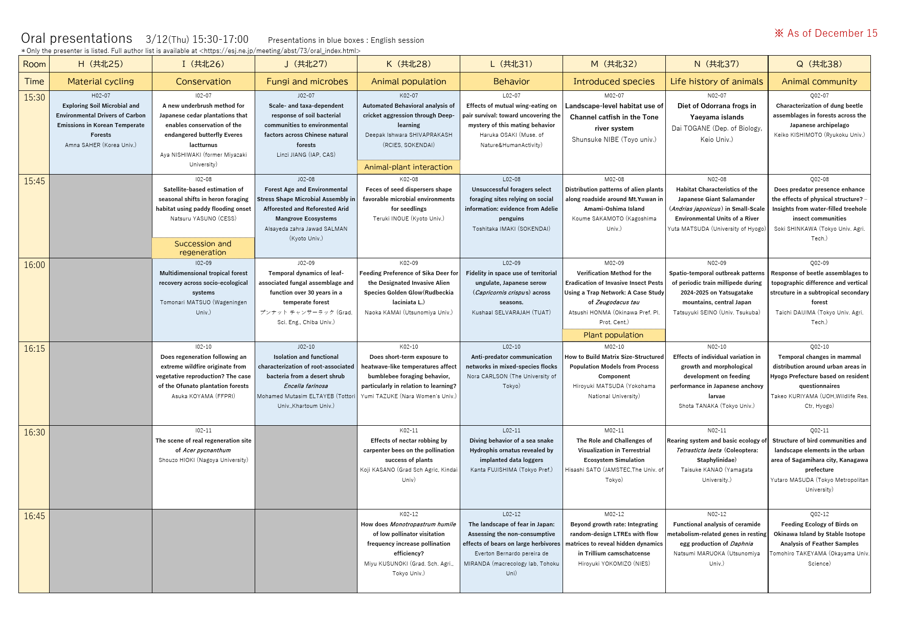
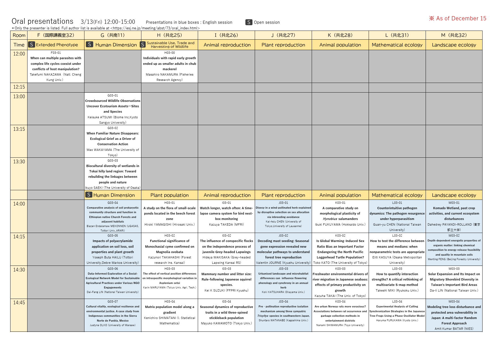
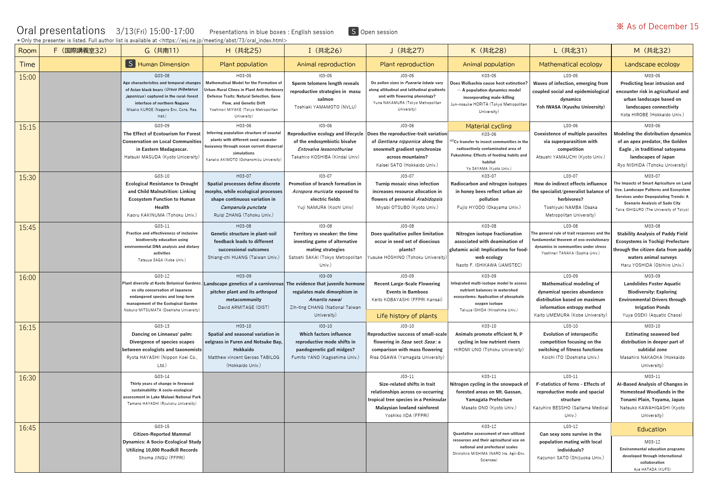

# Schedule

## Overall Schedule
<!---以下の一点目は、html作成時に赤字にしてください--->
- **The start and end times and layout of sessions are subject to change.** Please use this information as a reference when making reservations for airline tickets and accommodations.
- Details of each presentation date and time are now available on the <a href="https://esj.ne.jp/meeting/abst/74/index-e.html" target = "_blank">Conference Abstract Viewing Page</a>. The abstract of each presentation is now under preparation.

[**Download Schedule PDF**](/media/Timetable_en_ESJ73_20251215.pdf)

## Oral Sessions

- For details of each presentation, please refer to the <a href="https://esj.ne.jp/meeting/abst/74/oral_index.html" target="_blank">Oral Presentations Abstract Viewing Page</a> of the meeting.

[**Download Oral Presentation Programs PDF**](/media/EN_ESJ74_oral_20251215_tate.pdf)
<!---
[Oral presentation programs horizontal-PDF](/media/EN_ESJ73_oral_20251215_yoko.pdf)  
[Oral presentation programs vertical-PDF](/media/EN_ESJ73_oral_20251215_tate.pdf)
--->

